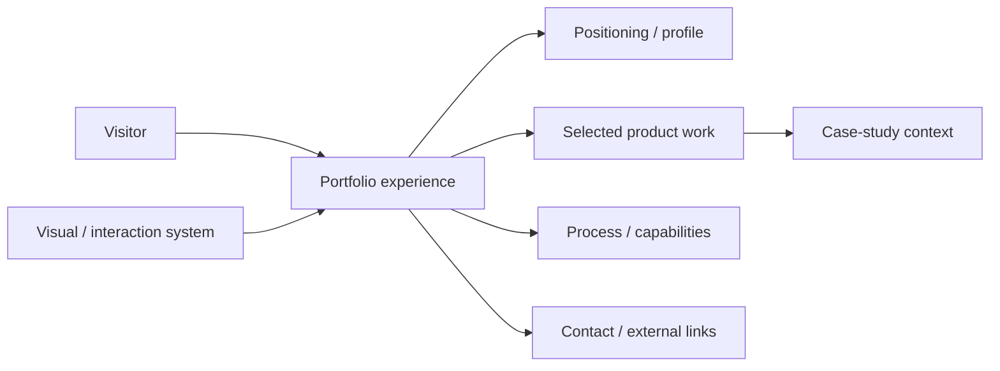
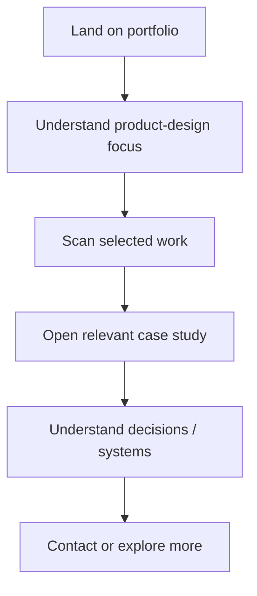
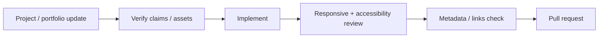

<div align="center">

# Nischhal Portfolio 2026

**A 2026 product-design portfolio project for presenting selected work, systems thinking, interaction design, and front-end-aware execution through a clear responsive website.**


[Browse source](https://github.com/Nischhalsubba/Nischhal-Portfolio-2026/tree/main) · [Issues](https://github.com/Nischhalsubba/Nischhal-Portfolio-2026/issues)

</div>

## Overview

**Nischhal Portfolio 2026** is documented as a product-design portfolio, not merely a gallery. Projects should communicate the problem, constraints, decisions, system thinking, interaction quality, and outcome evidence that can be verified.

<details open>
<summary><strong>🏗️ Interactive portfolio architecture</strong></summary>



</details>

## Visitor flow



## Audience guide

| Audience | Focus |
|---|---|
| Hiring / clients | Role, product thinking, evidence and fit |
| Developers | Site architecture, components, assets and delivery |
| Designers | Case-study storytelling, systems, interaction and visual quality |
| Content owner | Accurate claims, project context, links and metadata |

## Getting started

```bash
git clone https://github.com/Nischhalsubba/Nischhal-Portfolio-2026.git
cd Nischhal-Portfolio-2026
```

Use the manifests and lockfiles committed in the repository to determine the current runtime and commands.

## Portfolio quality

Show decisions and constraints, not just polished screens. Preserve readable case studies, useful captions, accessible images, reduced-motion behavior where needed, responsive layouts, and clear separation between concept work and shipped work.

## SEO & discoverability

Use accurate terms such as **product designer, UX designer, interaction design, design systems, product strategy, SaaS design, fintech design, Web3 UX, developer handoff, and product-design portfolio** only where supported by real work. Maintain Person/CreativeWork metadata where useful, unique titles/descriptions, semantic headings, canonical URLs and social previews.

## Contribution flow




## GitHub Pages (root-level sources)

`index.html`, `package.json`, `vite.config.ts`, `assets/`, and component sources are now at the repository root. Run `npm install && npm run build` from root; the GitHub Actions workflow publishes the generated `dist/` directory. The Vite `base` setting remains `/Nischhal-Portfolio-2026/` to keep GitHub Pages project URLs working. The former nested-site README is preserved in `docs/legacy-site-readme.md`.
